# Tom BSDF

Physically based hard-surface shaders for Koikatsu Sunshine and Unity 2019.4 Built-in Forward.

**[Interactive showcase](https://tomtom1010-iee.github.io/TomBSDF/)** · [User manual](https://tomtom1010-iee.github.io/TomBSDF/UserManual.html) · [Parameter reference](https://tomtom1010-iee.github.io/TomBSDF/Reference.html) · [Source and build guide](Assets/Mods/TomShadersBSDF/Documents/Build-Guide.md)

52 actual Unity GPU renders in 13 comparisons. Every subject uses the same standard UV sphere and fixed exposure. No per-image brightening or generated illustrations. Full-size images and recorded material settings are available in the showcase.

Seven modern entries cover opaque / cutout surfaces, premultiplied Alpha, Back/Front transparency, independent finite glass and two separate Tess displacement variants. Shared features include compensated GGX / Smith, EON diffuse, anisotropy, Probe / SH, AO, detail normals, specular AA, layered coat / absorption, thin film, POM local shadows and statistical Glints on supported entries.

## Use and Scope

- Current package: **0.2.0 RC1**. Packaged Editor auditing passed; the maintainer reported KKS / ME acceptance passed. [Release status](Assets/Mods/TomShadersBSDF/Documents/Release-Status.md).
- This repository is a rebuildable KKS source overlay, not a complete Unity project or an installable zipmod. [Installation and DLL paths](Assets/Mods/TomShadersBSDF/Documents/Installation.md). Compiled game packages are separate artifacts, not Git source.
- Core colors / physical shading do not need extra plugins. Rectangles, screen refraction, transparent native-map reuse and automatic displacement bounds use optional Companion **0.6.0 + matching Runtime**.
- Coverage is not optical transmission. Glass is a finite screen / parallel-slab approximation, not full GGX BTDF, nested media or a solid lens. Rectangles are unshadowed.
- Native Probe / SH needs scene data. The optional Studio Probe tool is independent; no V+ / TomShadersX pack is required. No modern KK / Unity 5.6 port is included.
- Screenshot promotion affects area integration only, not film / POM / Tess. The showcase is a visual reference, not forced character presets or an in-game performance claim.

Coverage uses an opaque checker, glass uses the matching scene-buffer service, and shadow tests use a shadow-only blocker. The grazing-light POM group is identified explicitly. [Capture notes](https://tomtom1010-iee.github.io/TomBSDF/CaptureNotes.html) explain the common display transform and image provenance.

## Hard-Surface Materials

[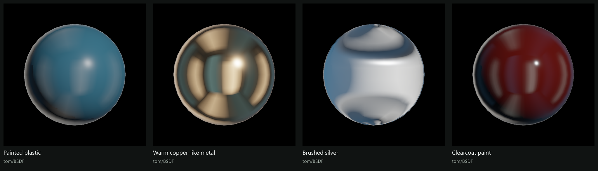](https://tomtom1010-iee.github.io/TomBSDF/#01-material)

## Metallic and Roughness

[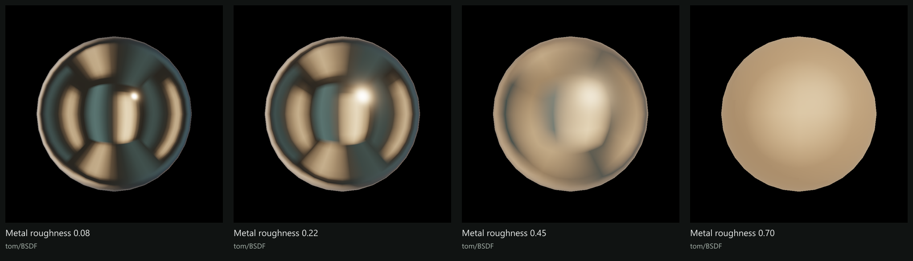](https://tomtom1010-iee.github.io/TomBSDF/#02-roughness)

## Anisotropy and Tangent Direction

[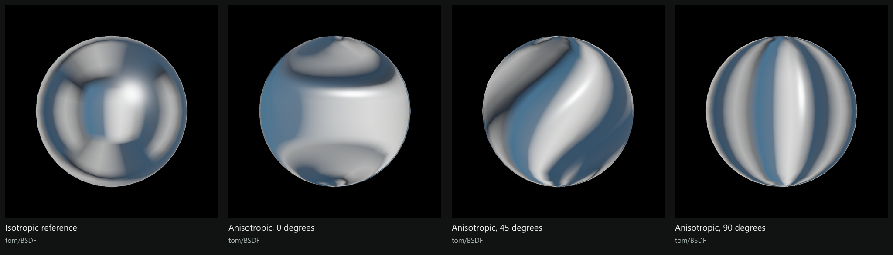](https://tomtom1010-iee.github.io/TomBSDF/#03-anisotropy)

## Independent Clearcoat Layer

[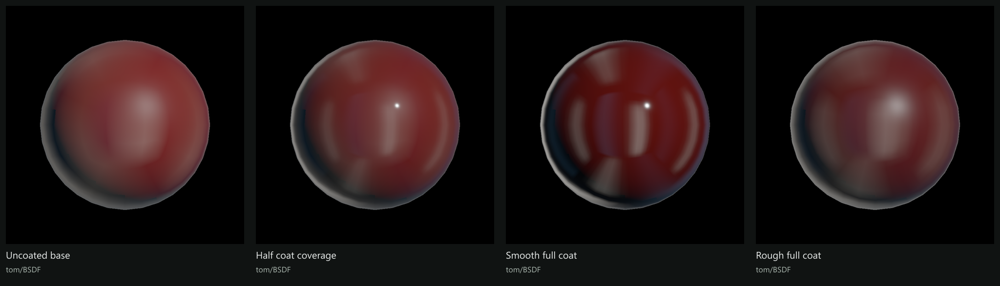](https://tomtom1010-iee.github.io/TomBSDF/#04-coat)

## Thin-Film Interference

[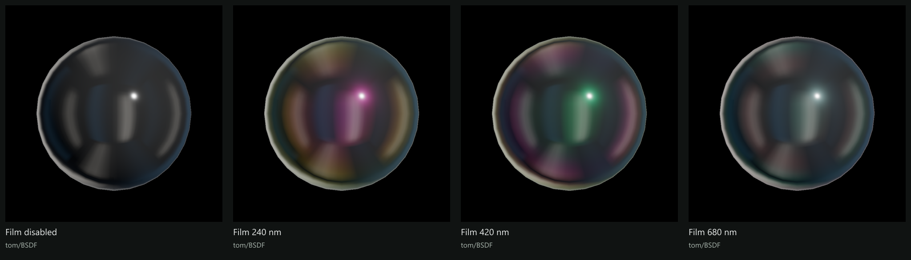](https://tomtom1010-iee.github.io/TomBSDF/#05-thin-film)

## Base, Detail and Coat Normals

[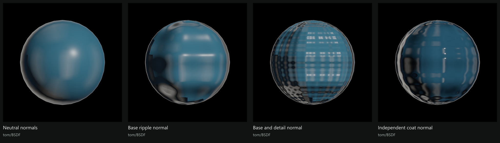](https://tomtom1010-iee.github.io/TomBSDF/#06-normals)

## Cutout, Coverage Alpha and Back/Front

[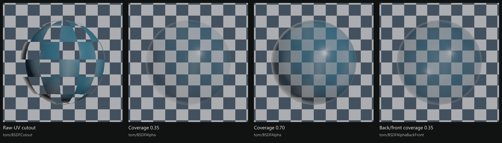](https://tomtom1010-iee.github.io/TomBSDF/#07-coverage)

## Statistical Glints

[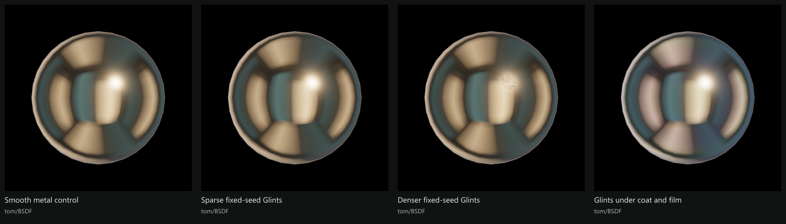](https://tomtom1010-iee.github.io/TomBSDF/#08-glints)

## POM and Local Height Shadows

[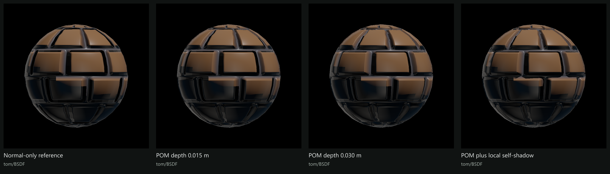](https://tomtom1010-iee.github.io/TomBSDF/#09-pom)

## Real Tessellation and Displacement

[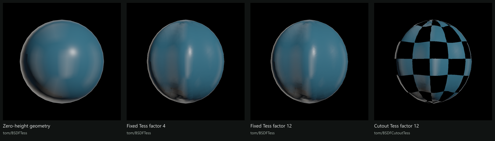](https://tomtom1010-iee.github.io/TomBSDF/#10-tess)

## Finite Glass and Screen Refraction

[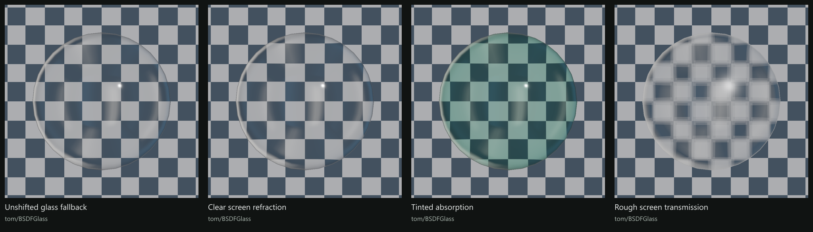](https://tomtom1010-iee.github.io/TomBSDF/#11-glass)

## Native, Environment and Area Lighting

[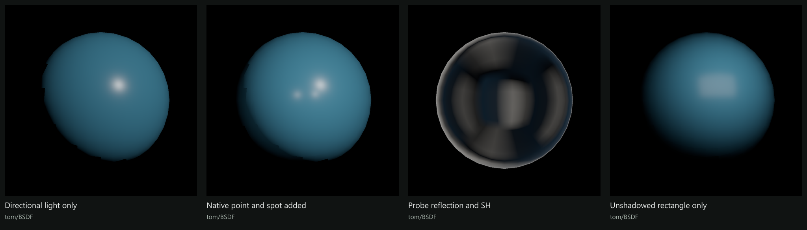](https://tomtom1010-iee.github.io/TomBSDF/#12-lighting)

## Native Real-Time Shadows

[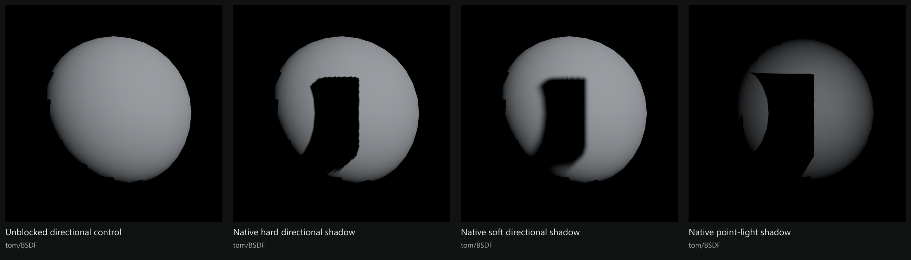](https://tomtom1010-iee.github.io/TomBSDF/#13-shadows)

## Development and License

Install Git LFS before cloning and run `git lfs pull`. Required prefabs, materials, Runtime, native LUTs and matching metadata are tracked; two large LUTs use LFS. Build outputs, cache, test intermediates, duplicate shader backups and obsolete tools remain excluded. Active legacy xukmi compatibility paths are retained.

Read the [build guide](Assets/Mods/TomShadersBSDF/Documents/Build-Guide.md), [documentation index](Assets/Mods/TomShadersBSDF/Documents/README.md), [contribution notes](CONTRIBUTING.md) and [support guide](SUPPORT.md). Before local edits, run `pwsh -File Tools/Validate-SourcePublication.ps1`. The old Unity compiler's cold-build issue is not declared fixed.

The repository [LICENSE](LICENSE), inherited [module MIT notice](Assets/Mods/TomShadersBSDF/LICENSE) and [LTC notice](Assets/Mods/TomShadersBSDF/ThirdParty/LTC-LICENSE.txt) are preserved.
